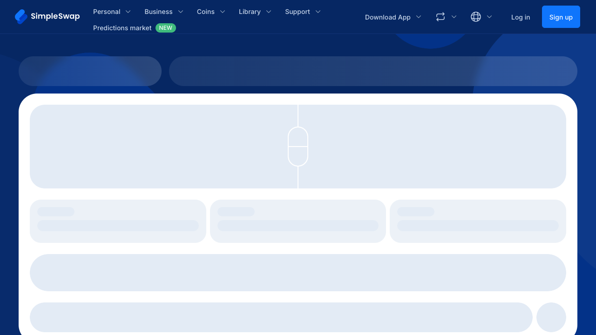
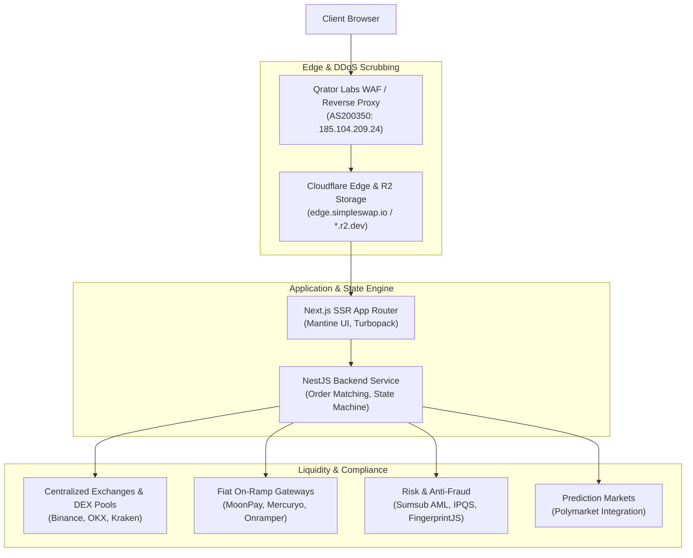

# SimpleSwap.io Reverse Engineering & Interactive Prototype

> A comprehensive reverse engineering analysis, forensic evidence capture, and functional clean-room prototype of [SimpleSwap.io](https://simpleswap.io), conducted using [REA (Reverse Engineer Anything)](https://github.com/morluto/rea) v6.8.0.

---

## 📸 Visual Capture



---

## 🎯 Project Overview

This repository contains:
1. **Interactive Prototype (`index.html`)**: A functional client-side simulator replicating SimpleSwap's non-custodial crypto exchange calculator, fixed vs. floating rate locks, address validation, and simulated multi-step order state machine.
2. **Forensic Evidence (`evidence/`)**: Live CDP Playwright browser scenario capture (`simpleswap-scenario.json`), accessibility tree, and cryptographically verified REA Evidence JSON (`simpleswap-evidence.json`, SHA-256: `ev_145edbfe2568cd550b6248b9f98dd975366b0004053dc7d5fb7af3093c83111a`).
3. **Full 10-Point Technical Report (`REPORT.md`)**: In-depth analysis of technical architecture, user flows, API integration, performance, security posture, and competitive landscape.

---

## 🏛️ System Architecture



### Stack Breakdown

* **Frontend**: Next.js (App Router, Turbopack code splitting), Mantine UI (`@mantine/core` v7+), Google Fonts (Inter & Poppins).
* **Backend**: NestJS microservices with RESTful Public API v3 (`https://api.simpleswap.io/v3/`).
* **Edge & Security**: Qrator Labs L3/L4/L7 DDoS mitigation proxy, Cloudflare R2 object storage, 2-year HSTS (`max-age=63072000`), Sectigo Wildcard TLS (`*.simpleswap.io`).
* **Compliance & AML**: Automated Sumsub transaction risk-scoring, IPQualityScore, and FingerprintJS device intelligence.
* **Catalog Size**: 2,800+ cryptocurrencies, fiat on-ramp pairs, and Polymarket prediction markets.

---

## 🚀 Running the Interactive Prototype

Simply open `index.html` in any modern web browser or serve it locally:

```bash
# Using python
python3 -m http.server 8080

# Or using npx serve
npx serve .
```

Then visit `http://localhost:8080` to interact with the swap calculator, test rate locks, inspect simulated API requests, and view the state machine in action.

---

## 📁 Repository Structure

```text
├── index.html                   # Interactive functional simulator & architecture explorer
├── REPORT.md                    # Complete 10-point reverse engineering report
├── README.md                    # Project documentation & overview
└── evidence/
    ├── simpleswap-capture.png   # Captured viewport screenshot from headless Chromium
    ├── simpleswap-evidence.json # Verified REA evidence bundle (JSON)
    └── simpleswap-scenario.json # REA browser scenario definition
```

---

## ⚖️ License & Disclaimer

This project is created for educational and security research purposes only. All trademarks, service marks, and company names are the property of their respective owners.

MIT License.
