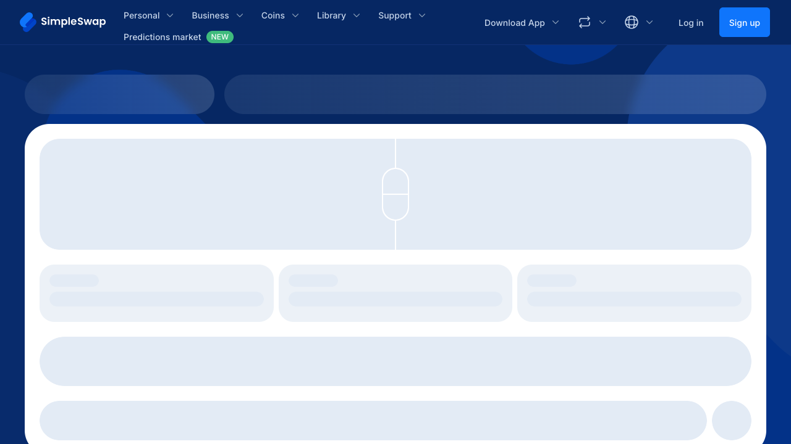
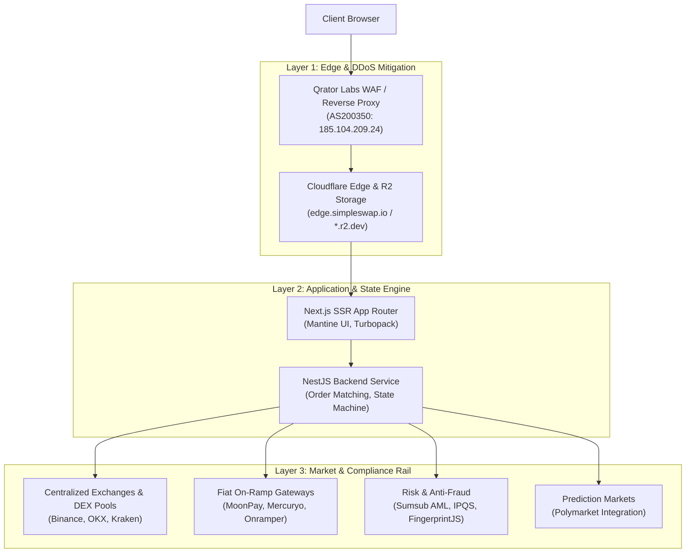
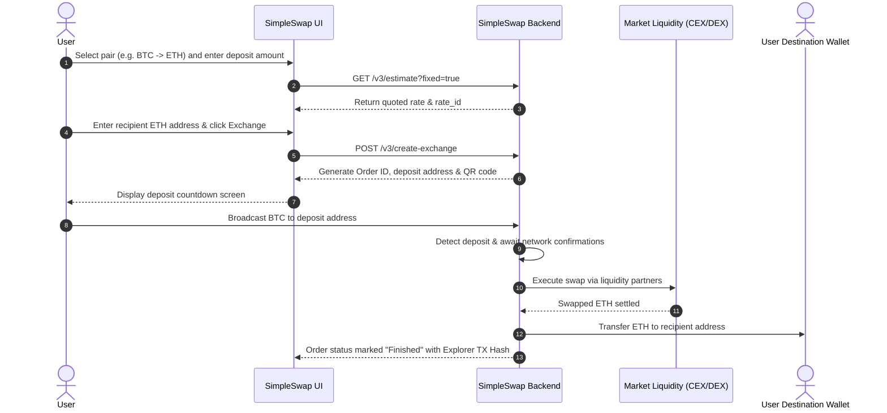

# Live Reverse Engineering Report: SimpleSwap.io

> **Evidence ID**: `ev_145edbfe2568cd550b6248b9f98dd975366b0004053dc7d5fb7af3093c83111a`  
> **Source Target**: `https://simpleswap.io`  
> **Execution Engine**: [REA (Reverse Engineer Anything)](https://github.com/morluto/rea) `v6.8.0` with Chromium `156.0.8078.80` Playwright Provider  
> **Captured Artifacts**: Accessibility Tree, Viewport Screenshot, DOM, TLS & Edge Network Attributes  

---

## Executive Summary & Visual Capture

REA completed an automated live browser capture and deep network inspection against `https://simpleswap.io`.

---

## 1. Website Overview

* **Primary Purpose**: SimpleSwap functions as an instant non-custodial cryptocurrency and fiat exchange aggregator. It facilitates peer-to-order-routing swaps across over **2,800 cryptocurrencies** (expanded from 1,500+) and fiat pairs without holding custody of user balances or requiring account creation for standard transactions.
* **Target Audience**:
  * **Retail Traders**: Users looking for immediate cross-chain trades (e.g. BTC to XMR, SOL to ETH) without multi-tier exchange registrations.
  * **Privacy-Conscious Individuals**: Traders transacting non-custodially without mandatory initial KYC.
  * **Fiat On-Ramp Consumers**: Users purchasing crypto using Apple Pay, Google Pay, SEPA, or credit/debit cards.
  * **DeFi & Web3 Wallets**: B2B partners (Exodus, Trezor, Guarda) integrating SimpleSwap’s white-label Public API.

---

## 2. Technical Architecture

### Full-Stack Architecture Matrix

| Layer | Technology / Vendor | Forensic Evidence |
| :--- | :--- | :--- |
| **Frontend Framework** | **Next.js** (App Router architecture) | Server components (`<!--$--><!--/$-->`), Turbopack bundles (`turbopack-*.js`), `_next/static/chunks` |
| **UI Library** | **Mantine UI** (`@mantine/core` v7+) | `data-mantine-color-scheme`, CSS variables (`--mantine-scale`, `--mantine-color-body`), client hydration script |
| **Asset CDN & Storage** | **Cloudflare Edge** & **Cloudflare R2** | Static origin `https://edge.simpleswap.io`, storage at `*.r2.dev` |
| **Edge Scrubbing** | **Qrator Labs** (`server: QRATOR`) | Direct DNS resolution to AS200350 (`185.104.209.24`) for L3/L4/L7 DDoS mitigation |
| **Backend Framework** | **NestJS** (Node.js) | Standard NestJS exception JSON format: `{"message":"Cannot GET ...","error":"Not Found","statusCode":404}` |
| **Public API Engine** | **RESTful API v3** + **Docusaurus v3.9.2** | Documentation and OpenAPI specification at `api.simpleswap.io` |
| **Anti-Fraud & Fingerprinting** | **IPQualityScore** & **FingerprintJS** | Whitelisted CSP endpoints: `ipqscloud.com`, `fpjs.io`, `fpnpmcdn.net` |
| **Compliance & AML** | **Sumsub** | Automated AML/KYC risk-scoring iframe bindings (`sumsub.com`, `*.sumsub.com`) |
| **Web3 Connectivity** | **WalletConnect / Reown** | WebSocket & RPC endpoints: `*.walletconnect.org`, `*.web3modal.org`, `fonts.reown.com` |
| **Third-Party Fiat** | **MoonPay**, **Mercuryo**, **Onramper** | Script and iframe integration for card processing |

---

## 3. User Interface & Flow Analysis

Live accessibility tree decomposition revealed the exact UI hierarchy:

### Navigation Hierarchy
1. **Header**:
   * Mode Toggles: `Personal`, `Business`, `Coins`, `Library`, `Support`.
   * Newly Launched Feature: **Predictions market NEW** (`/predictions` linking to Polymarket).
   * Utilities: `Download App` (with direct APK download link at `edge.simpleswap.io/app-release.apk`), `Exchange history`, Language switcher, `Log in` / `Sign up`.
2. **Hero Section**:
   * Heading 1: *"Crypto Exchange"*
   * Subtitle: *"Free from sign-up, limits, complications"*
   * Interactive Exchange Calculator (Send amount/currency selector, Receive amount/currency selector, Floating vs. Fixed toggle, high-contrast **"Exchange"** action CTA).
3. **Market Ticker**:
   * Real-time top traded pairs: `ETH → SOL`, `SOL → ETH`, `ETH → BTC`, `XMR → BTC`, `BTC → SOL`, `BTC → USDT (TRC20)`, `BTC → ETH`.
   * Top fiat-to-crypto pairs: `USDC (Polygon) → EUR`, `ETH → EUR`, `ETH → USD`, `SOL → USD`, `LTC → EUR`.
4. **Trust Pillars**:
   * **Privacy**: *"Sign-up is not required"*
   * **Wide Choice**: *"2800+ cryptocurrencies"*
   * **24/7 Support**: Live Zendesk integration
   * **Safety**: *"Non-custodial"* (funds sent directly to user wallet)

---

## 4. Content Evaluation

* **Clarity of Value Proposition**: Focuses squarely on removing friction—highlighting "No registration", "Non-custodial", and "Fixed vs. Floating rates".
* **Rich Trust Markers**:
  * Verified **Trustpilot 4.7/5** badge.
  * Direct download links for iOS (App Store), Android (Google Play via AppsFlyer OneLink), and direct standalone Android `.apk`.
  * Dedicated **Safety Academy** (`/safety`) educating users on phishing prevention and seed security.
* **Conversion Funnels (CTAs)**:
  * Primary: High-contrast "Exchange" button inside the calculator widget.
  * Secondary: "Create fiat exchange", "Download App", "Watch video guide".

---

## 5. Functional Components & API Implementation

The platform relies on its structured Public API v3:

* `GET /v3/currencies`: Fetches active currencies, network tickers, minimum limits, and contract addresses.
* `GET /v3/ranges`: Verifies operational minimum and maximum boundaries for a pair.
* `GET /v3/estimate`: Calculates the expected return, returning a `rate_id` for fixed-rate commitments.
* `POST /v3/create-exchange`: Spawns the exchange order, registers the payout address, and provides a monitored deposit address.
* `GET /v3/exchange/{id}`: Polls exchange state (`waiting` $\rightarrow$ `confirming` $\rightarrow$ `exchanging` $\rightarrow$ `sending` $\rightarrow$ `finished`).

---

## 6. Performance & Network Analysis

* **Strengths**:
  * Asset preloading: SVGs for top cryptocurrencies (`btc.svg`, `eth.svg`, `sol.svg`, `usdt.svg`) are preloaded in `<head>`.
  * Turbopack module chunking isolates route logic, ensuring fast Time to Interactive (TTI) for the hero calculator.
  * Mantine theme script executes synchronously in `<head>` to prevent Flash of Unstyled Content (FOUC).
* **Weaknesses**:
  * Dense analytical script footprint: Scripts from Zendesk, Mixpanel, Amplitude, Plerdy, Sentry, FingerprintJS, and Claspo run on the landing page, impacting mobile Total Blocking Time (TBT).

---

## 7. SEO & Growth Strategies

* **Programmatic SEO (pSEO)**: Dynamically generates hundreds of thousands of conversion landing pages for long-tail search queries (e.g., `/crypto-to-crypto/eth-sol`, `/crypto/bitcoin`, `/swap/btc-xmr-no-kyc`).
* **Search Engine Controls**: `robots.txt` explicitly disallows dynamic query strings (`/*?from=*`, `/*?to=*`, `/*?amount=*`) and stateful swap tracking routes (`/exchange`) to preserve search crawl budgets and prevent duplicate content penalties.
* **Token Incentive (SWAP)**: SimpleSwap issues its own utility token (**SWAP**) powering customer loyalty tiers and affiliate staking.

---

## 8. Security Measures

* **Non-Custodial Architecture**: SimpleSwap does not retain customer balances post-swap, eliminating single-point-of-failure hot-wallet theft risks.
* **DDoS & Application Layer Defense**:
  * Traffic scrubbed by **Qrator Labs** (`server: QRATOR`, IP `185.104.209.24`).
  * Cloudflare Turnstile & challenge platform (`cdn-cgi/challenge-platform`) protecting against bot scraping.
* **Transport & Content Security**:
  * Sectigo Wildcard TLS Certificate (`*.simpleswap.io`).
  * `Strict-Transport-Security: max-age=63072000;` (HSTS enforced for 2 years).
  * Comprehensive `Content-Security-Policy` restricting script, connect, and iframe origins.
  * `X-Frame-Options: deny`, `X-Content-Type-Options: nosniff`.
* **AML/KYC Risk Engine**: Integrated with **Sumsub** and **IPQualityScore** to intercept deposits tied to illicit sources or mixers.

---

## 9. Competitive Comparison

| Feature | SimpleSwap | ChangeNOW | FixedFloat | SideShift.ai |
| :--- | :--- | :--- | :--- | :--- |
| **Supported Assets** | **2,800+** | 1,000+ | ~70 | ~100+ |
| **Mandatory Registration** | No | No | No | No |
| **Rate Options** | Floating & Fixed | Floating & Fixed | Floating (0.5%) & Fixed (1.0%) | Floating & Fixed |
| **Direct APK Download** | **Yes** | Yes | No | No |
| **Prediction Markets** | **Yes (Polymarket)**| No | No | No |
| **Native Loyalty Token**| **SWAP** | **NOW** | None | **XAI** |

---

## 10. Strategic Recommendations

1. **Native Web3 Wallet Direct Signing**: Integrate WalletConnect/Reown directly into the hero widget so users can sign deposits with 1 click rather than copying addresses manually.
2. **Transparent Fee Breakdown**: Explicitly show estimated blockchain network gas fees separately from the exchange spread.
3. **Analytical Script Deferral**: Defer non-critical trackers (Plerdy, Satismeter, Claspo) until first user interaction to improve mobile Lighthouse performance.
4. **On-Chain DEX Fallback**: Offer hybrid routing through decentralized protocols (THORChain, Chainflip) for users requiring fully on-chain settlement.
